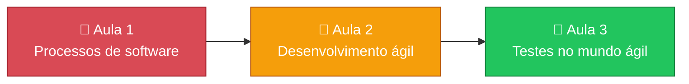

<div align="center">

# 🎓 Metodologias Ágeis e Ciclo de Desenvolvimento de Software

### $\color{#d94a55}{\textsf{Resumos ilustrados do curso}}$ $\color{#8b949e}{\textsf{em}}$ $\color{#3b82f6}{\textsf{3 arquivos HTML}}$

    

*Curso da DIO · Professora **Carolina Santana Louzada** · Analista de QA*

</div>

---

## 🟥🟧🟨🟩🟦🟪 &nbsp;$\color{#3b82f6}{\textsf{O que tem nesta pasta}}$

Cada arquivo é o **resumo de uma aula do curso**. Dentro dele você encontra, vídeo por vídeo, o nome do `.mp4`, a duração, o resumo do conteúdo e os **slides** do vídeo.

| Aula | Arquivo | Vídeos resumidos |
|:-:|---|---|
|  | `(1)_Processos de software.html` | Apresentação do curso · Definindo processo, fluxo e padrões · Modelo Prescritivo · Modelos incremental, iterativo e concorrente · Modelos especializados · Processo Unificado |
|  | `(2)_Desenvolvimento.html` | O manifesto ágil · Extreme Programming (XP) · Scrum · Outros modelos ágeis |
|  | `(3)_Testes no mundo.html` | Contextualizando a atividade de teste · Testes nas abordagens ágeis · Métodos de testes nos modelos ágeis · Conclusão |

> [!NOTE]
> Os arquivos têm só os **nomes diferentes**: o conteúdo é o mesmo dos resumos originais. Os slides estão **dentro** de cada HTML, então cada arquivo funciona sozinho, sem pasta de imagens e sem internet.

---

## 👀 &nbsp;$\color{#f97316}{\textsf{Como fica no navegador}}$

É assim que cada arquivo aparece depois de aberto no navegador:

**📘 Aula 1** · tema claro, com a barra de botões numerados e os slides de cada vídeo


**🚀 Aula 2** · grade de slides do vídeo do Scrum


**🧪 Aula 3** · o **tema escuro** liga sozinho se o seu sistema estiver no modo escuro


---

## ⚠️ &nbsp;$\color{#a855f7}{\textsf{Importante: o GitHub não mostra o resumo}}$

```diff
- No GitHub: você vê só o código HTML
+ No navegador (depois de baixar): você vê a página pronta, com slides e cores
```

> [!IMPORTANT]
> Para ver o resumo bonito, é preciso **baixar o arquivo e abrir no navegador**.

---

## 🚀 &nbsp;$\color{#22c55e}{\textsf{Como usar}}$

### 1️⃣ &nbsp;$\color{#d94a55}{\textsf{Baixar}}$

Escolha a forma que for mais fácil:

- 📄 **Um arquivo só:** clique no arquivo aqui no GitHub e use o botão **Download raw file** (ícone de seta para baixo, no canto direito acima do código).
- 📦 **Tudo de uma vez:** na página inicial do repositório, clique em **Code → Download ZIP** e extraia.
- ⌨️ **Pelo terminal:**
  ```bash
  git clone <link-do-repositorio>
  ```

### 2️⃣ &nbsp;$\color{#f59e0b}{\textsf{Abrir no navegador}}$ 🌐

Abra o arquivo baixado em **qualquer navegador**:      

- 🖱️ **Clique duplo** no arquivo `.html`, ou
- 📂 **Botão direito → Abrir com →** escolha o navegador, ou
- 🪟 **Arraste** o arquivo para dentro de uma janela do navegador.

No Linux, pelo terminal (as aspas são necessárias por causa dos espaços e parênteses no nome):

```bash
xdg-open "(1)_Processos de software.html"
```

### 3️⃣ &nbsp;$\color{#007acc}{\textsf{Alternativa: VS Code}}$ 💻

Se preferir não usar o navegador diretamente, dá para ver pelo **VS Code**:

1. Abra a pasta no VS Code.
2. Instale a extensão **Live Preview** (da Microsoft) ou **Live Server**.
3. Clique no arquivo `.html` e abra a visualização pela extensão.

> [!WARNING]
> Se abrir o `.html` no VS Code sem a extensão, você verá só o código. Para ver a página pronta, use o navegador ou a extensão de preview.

---

## ✨ &nbsp;$\color{#ec4899}{\textsf{Dicas de navegação}}$

> [!TIP]
> - 🔢 No topo de cada página há **botões numerados** para pular direto para um vídeo.
> - 🌙 O tema **claro ou escuro** acompanha a configuração do seu sistema.
> - 📱 Funciona também no celular.
> - 🖨️ Dá para imprimir ou salvar em PDF pelo navegador (**Ctrl + P**).

---

## 🗺️ &nbsp;$\color{#14b8a6}{\textsf{Mapa do curso}}$



---

<div align="center">

 

</div>
